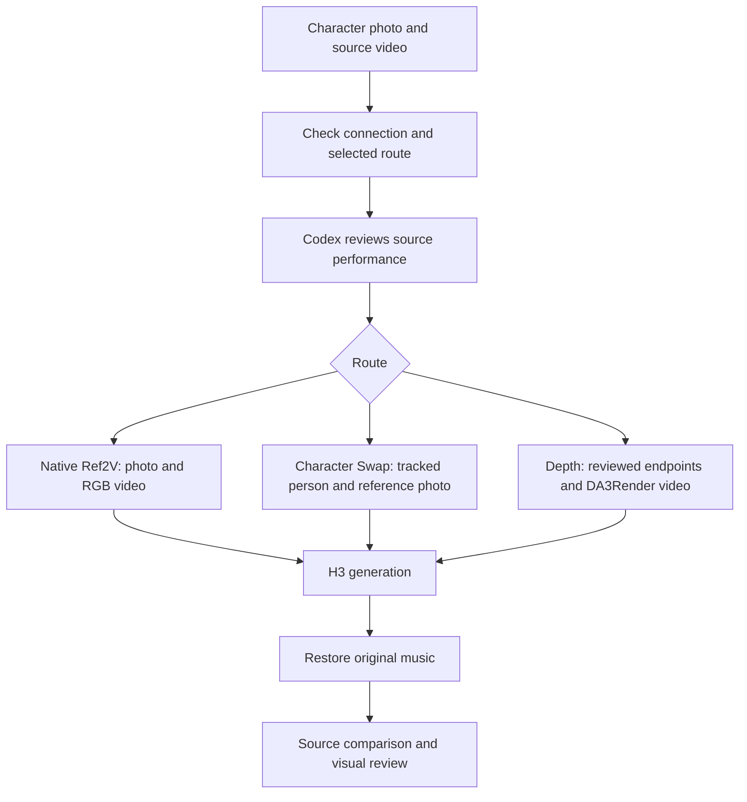

# MiniMax H3 Dance Replica

English | [中文](README.zh.md)

## Overview

A Codex Agent Skill for making a new dance video from a character photograph and a performance reference. It prepares the inputs, selects an explicit MiniMax H3 workflow in ComfyUI, preserves the original music and returns a synchronized comparison for review.

Use it when you want the photographed character to perform a reference dance. Motion, facial identity, clothing and continuity need separate review; generation completion does not mean every movement matches the source.

## Preview

Three complete outputs from earlier tasks, each with its original music. Appearance and motion still vary from the references; these are not frame-exact reproductions.

### Wine-red dress: full dance with HD refinement

https://github.com/user-attachments/assets/60f3d8de-1491-41bc-88f9-36170e7ef873

[Play video · 14.29 seconds](assets/videos/wine-dress-full-dance.mp4)

### Wine-red dress: depth-guided dance

https://github.com/user-attachments/assets/289cb5e0-4bcd-435f-abb6-ec246b457975

[Play video · 7.17 seconds](assets/videos/wine-dress-depth-dance.mp4)

### Floral dress: native Ref2V guidance

https://github.com/user-attachments/assets/57031253-132d-4518-b507-9b273f4e176a

[Play video · 8.17 seconds](assets/videos/ref2v-floral.mp4)

## Features

| Capability | What it helps you do |
|---|---|
| Photograph-guided dance video | Use the approved character photo and an RGB performance video through native Ref2V |
| Character replacement workflow | Use Character Swap V1.5 with person tracking and the matching H3 recipe |
| Depth-guided generation | Use DA3/DA3Render and reviewed first/last images when choosing the depth route |
| Source-based action prompts | Let Codex inspect the performance and describe its observed timing and expression amplitude |
| Original music and comparison | Restore the source audio and compare the result on the source timeline |
| Setup and recovery | Check requirements and resume matching tasks without blindly submitting another video job |

Direct Ref2V and Character Swap tasks currently accept 2–15 seconds. The depth route also provides shared-boundary segmentation for longer sources. Timed text is a soft instruction, not frame-locked motion control.

## Installation

### Requirements

Prepare the client first; GPU software and weights belong on the inference host. Codex can guide setup for the route you select.

| Item | Requirement |
|---|---|
| Agent client | Codex with local file and command access |
| Client runtime | Python 3.10 or newer and FFmpeg/FFprobe; Codex checks the client packages and FFmpeg features |
| Inference service | Reachable native ComfyUI or a compatible workflow API; remote API users need no local ComfyUI or GPU |
| Materials | An approved adult character photo and a reference dance video |
| Authentication | A key file or environment variable when required by the service |
| Depth endpoints | Codex image editing, or reviewed user-supplied first/last images; not required for the direct routes |

### Quick Installation

Ask Codex:

> Install this Skill: https://github.com/chemny/minimax-h3-dance-replica
> Check the client environment, prepare missing requirements, then install and verify that the skill loads. Set up the selected ComfyUI route when I need it.

Codex should report skill discovery, missing requirements and connection readiness separately. Follow the [installation guide](references/installation.md) for model sources, directories and checks. It never downloads weights automatically.

## Quick Start

Provide your portrait, a short single-shot dance video and the service address, then ask:

> Make a dance video with the person in this photo, using this video for the performance. Use native Ref2V with eight steps and a 512-pixel motion reference, and keep the original music.

Codex returns the video and a synchronized comparison, noting remaining appearance or motion differences.

## Usage Examples

### Replace a dancer with Character Swap

> Use Character Swap to replace the dancer with the person in this photo. Keep the complete video and original music, then compare the actions and clothing.

The selected ComfyUI service needs the Relay/SAM nodes and the Character Swap model combination in the [route guide](references/routes.md).

### Use depth and first/last images

> Use the depth route with this photo and dance video. Prepare and check the endpoint images, then generate the video with its original music.

Codex image editing or supplied endpoint images are needed. Longer depth tasks are planned before image generation so neighboring segments share the same boundary image.

### Use an existing API

> Use my existing workflow API for this task. Check its supported workflow and actual model settings first; I will provide the address and key-file location.

The bundled adapter supports the documented workflow API contract for Ref2V and Character Swap. Arbitrary vendor video APIs require a separate adapter.

### Continue an interrupted task

> Continue this existing task from its saved records. Reuse the generation job and finish the music and comparison without generating the video again.

Use unchanged inputs and the same task directory. See [recovery](references/recovery.md).

## How It Works

Codex observes the source performance and reviews visual quality. The scripts perform repeatable preparation, workflow submission and finishing.

| Component | Responsibility |
|---|---|
| `SKILL.md` | Route selection, material roles and acceptance rules |
| `dance.py`, `routes.py`, `profiles.py` and presets | Unified task entry and explicit model/sampling recipes |
| `direct_routes.py`, `h3_run.py` and the Character Swap graph | Build the selected H3 workflow |
| `native_client.py`, `workflow_client.py` | Upload, submit, retrieve and recover the same task |
| Environment checkers, `runtime_checks.py`, `model_inventory.py` | Check the client/host requirements and list pinned model sources |
| `media.py`, `stages.py`, `segments.py` | Prepare the timeline, checkpoint local work, restore audio and join depth segments |
| `prompt.py`, `compare.py` | Compile observed performance records and create comparisons for visual review |
| `depth_remote.py` | Optional DA3 helper for an existing server-side Python environment |



Environment checks, model inventory and graph validation can run independently without generating a video. Depth uses native ComfyUI; the other two routes can also use the compatible workflow API.

## Repository Structure

```text
minimax-h3-dance-replica/
├── SKILL.md
├── agents/openai.yaml
├── scripts/                   Task entry, clients, media and setup helpers
├── presets/                   Recipes and pinned model metadata
├── assets/                    Character Swap graph and visual preview
├── examples/                  Task configurations; no sample media
├── references/                Installation, routes, recovery and acceptance
├── tests/                     CPU-only route/protocol/recovery checks
├── Check-Environment.bat
├── requirements.txt           Client packages
├── README.md
└── README.zh.md
```

The package contains instructions, scripts, a workflow graph and the three demo videos. Model weights and source footage are not bundled. See [runtime commands](references/runtime.md), [installation](references/installation.md), [route recipes](references/routes.md), [recovery](references/recovery.md) and [development checks](references/development.md).

## License

The code and documentation use the [MIT License](LICENSE). Model weights, upstream components and demo media are outside this project's code license.

## About Me

[Neo Chen (chemny)](https://github.com/chemny). Use GitHub to get in touch or share feedback.
