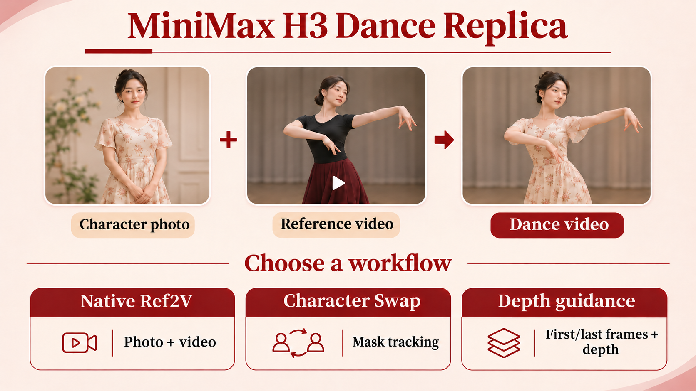

# MiniMax H3 Dance Replica

English | [中文](README.zh.md)

A dance-replication Skill for Codex. Provide a character photo and a reference video to generate a new dance video with MiniMax H3 and ComfyUI, keeping the original music.

## Examples

### [Wine-red dress: full dance · 14.29 seconds](assets/videos/wine-dress-full-dance.mp4)

https://github.com/user-attachments/assets/60f3d8de-1491-41bc-88f9-36170e7ef873

### [Wine-red dress: turning dance · 7.17 seconds](assets/videos/wine-dress-depth-dance.mp4)

https://github.com/user-attachments/assets/289cb5e0-4bcd-435f-abb6-ec246b457975

### [Floral dress dance · 8.17 seconds](assets/videos/ref2v-floral.mp4)

https://github.com/user-attachments/assets/57031253-132d-4518-b507-9b273f4e176a

Character details and movements may still differ from the references.

## Installation

Requires Python 3.10+, FFmpeg, and a reachable ComfyUI service or compatible API.

Ask Codex:

> Install this Skill and check the runtime requirements: https://github.com/chemny/minimax-h3-dance-replica

## Usage

Provide the character photo, reference video and service address, then ask Codex:

> Make the person in this photo perform the reference dance and keep the original music.

Choose native Ref2V, Character Swap or depth guidance.

## Documentation

[Installation](references/installation.md) · [Workflows](references/routes.md) · [Parameters](references/runtime.md) · [Recovery](references/recovery.md) · [Architecture](references/architecture.md)

---

Code and documentation: [MIT](LICENSE). Models, upstream components and demo media are excluded. By [Neo Chen (chemny)](https://github.com/chemny).
