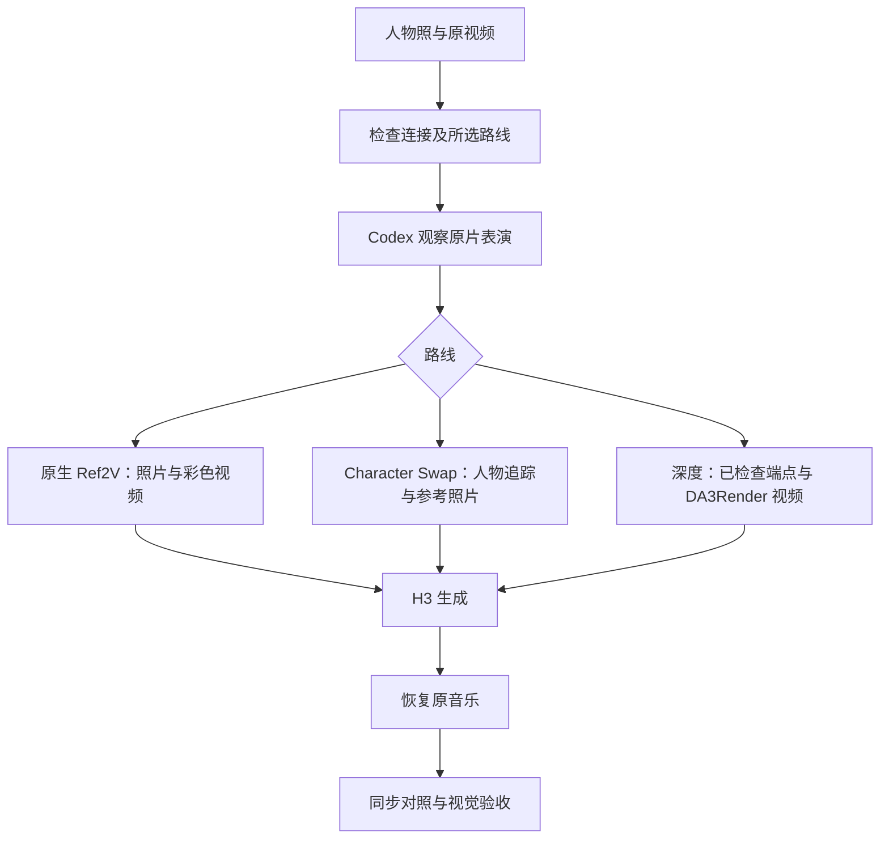

# MiniMax H3 Dance Replica

[English](README.md) | 中文

## 项目简介

这是一个供 Codex 使用的 Agent Skill：根据人物照片和舞蹈参考视频，调用 ComfyUI 中明确选择的 MiniMax H3 工作流，生成新人物的舞蹈视频，保留原音乐，并提供同步对照。

适合希望让照片中的人物表演参考舞蹈的用户。人物、服装、动作和连续性需要分别检查；生成完成不代表每个动作都与原片一致。

## 效果预览

三个历史任务的完整无声成片；人物细节和动作仍有偏差，不代表逐帧一致。

### 酒红裙：人物与场景引导

<video src="assets/videos/ref2v-wine-dress.mp4" controls preload="metadata" width="320"></video>

[播放视频 · 7.17 秒](assets/videos/ref2v-wine-dress.mp4)

### 碎花裙：Character Swap 换人

<video src="assets/videos/character-swap-floral.mp4" controls preload="metadata" width="320"></video>

[播放视频 · 7.17 秒](assets/videos/character-swap-floral.mp4)

### 碎花裙：原生 Ref2V 引导

<video src="assets/videos/ref2v-floral.mp4" controls preload="metadata" width="320"></video>

[播放视频 · 8.17 秒](assets/videos/ref2v-floral.mp4)

## 核心功能

| 能力 | 它能帮你做什么 |
|---|---|
| 照片引导舞蹈生成 | 通过原生 Ref2V，使用已确认的人物照和原彩色视频参考 |
| 人物替换工作流 | 通过 Character Swap V1.5、人物追踪及匹配的 H3 配方替换人物 |
| 深度引导生成 | 选择深度路线时，使用 DA3／DA3Render 和已检查的首尾图 |
| 根据原片编写动作提示 | 由 Codex 观察动作时间、姿态和表情幅度 |
| 原音乐与同步对照 | 恢复原音轨，在原时间轴上检查结果 |
| 环境检测与任务恢复 | 检查所需环境，恢复同一任务，避免盲目重复生视频 |

原生 Ref2V 和 Character Swap 直接任务目前支持 2–15 秒；深度路线另有共享边界的长视频分段。分时提示词是文字引导，不能锁定每一帧动作。

## 安装

### 配置要求

先准备客户端；GPU 软件和权重放在推理主机上。Codex 可按所选路线引导配置。

| 项目 | 要求 |
|---|---|
| Agent 客户端 | 可访问本地文件并执行命令的 Codex |
| 客户端运行环境 | Python 3.10 或更新版本、FFmpeg／FFprobe；由 Codex 检查所需 Python 包及 FFmpeg 功能 |
| 推理服务 | 可访问的原生 ComfyUI 或兼容工作流 API；远程 API 用户无需本机安装 ComfyUI 或配备 GPU |
| 素材 | 已确认的成年人物照片和舞蹈参考视频 |
| 身份认证 | 服务要求时，使用密钥文件或环境变量 |
| 深度路线首尾图 | Codex 图像编辑工具，或用户提供的已检查图片；直接路线不需要 |

### 快速安装

在 Codex 中发送：

> 帮我安装这个 Skill：https://github.com/chemny/minimax-h3-dance-replica
> 先检查客户端环境，缺什么帮我补齐，再安装并确认技能可以加载。需要生成时，再配置选定的 ComfyUI 路线。

Codex 应分别说明技能是否可发现、环境缺项及服务是否可连接。模型来源、目录和检查方法见[安装指南](references/installation.md)，脚本不会自动下载权重。

## 快速开始

提供人物照、一段短的单镜头舞蹈视频及服务地址，然后发送：

> 用这张照片中的人物复刻这个视频的舞蹈。使用原生 Ref2V、八步采样和 512 动作参考，保留原音乐。

Codex 会交付视频及同步对照，并说明仍存在的人物或动作偏差。

## 使用示例

### 用 Character Swap 替换舞者

> 用 Character Swap 把视频中的舞者替换成这张照片的人物。保留完整时长和原音乐，再对照动作和服装。

所选服务需要 Relay／SAM 节点及[路线指南](references/routes.md)中列出的 Character Swap 模型组合。

### 使用深度与首尾图

> 用深度路线处理这张人物照和舞蹈视频。先制作并检查首尾图，再生成视频，保留原音乐。

需要 Codex 图像编辑能力或已有首尾图。较长深度任务会先计算分段，让相邻片段复用同一张边界图。

### 使用已有 API

> 用我已有的工作流 API 做这个任务。先核对它支持的工作流和实际模型设置，我会提供地址及密钥文件位置。

内置适配器支持约定的 Ref2V／Character Swap 工作流协议；其他厂商的视频 API 需要单独适配。

### 继续中断的任务

> 按已有记录继续这个任务。复用生成任务，完成原音乐和对照制作，不要重新生视频。

使用相同输入及原任务目录，详见[恢复说明](references/recovery.md)。

## 工作原理

Codex 负责观察表演和判断画面质量，脚本负责可重复的素材处理、工作流提交和后处理。

| 组件 | 职责 |
|---|---|
| `SKILL.md` | 路线选择、素材角色和验收规则 |
| `dance.py`、`routes.py`、`profiles.py` 与预设 | 统一任务入口及明确的模型／采样配方 |
| `direct_routes.py`、`h3_run.py` 与 Character Swap 图 | 构建选定的 H3 工作流 |
| `native_client.py`、`workflow_client.py` | 上传、提交、取图及恢复同一任务 |
| 环境检测器、`runtime_checks.py`、`model_inventory.py` | 检查客户端与服务端条件，列出固定版本的模型来源 |
| `media.py`、`stages.py`、`segments.py` | 准备时间轴、保存本地处理检查点、恢复音轨及拼接深度片段 |
| `prompt.py`、`compare.py` | 编译实际观察记录，生成供视觉验收的同步对照 |
| `depth_remote.py` | 在已有服务器 Python 环境中运行 DA3 的可选辅助脚本 |



环境检测、模型清单和图校验可以独立执行，不生成视频。深度使用原生 ComfyUI，另外两条路线也可通过兼容工作流 API 调用。

## 目录结构

```text
minimax-h3-dance-replica/
├── SKILL.md
├── agents/openai.yaml
├── scripts/                   任务入口、客户端、素材处理与环境工具
├── presets/                   配方与固定版本的模型元数据
├── assets/                    Character Swap 工作图和效果预览
├── examples/                  任务配置；不含示例媒体
├── references/                安装、路线、恢复和验收说明
├── tests/                     仅 CPU 的路由、协议与恢复检查
├── Check-Environment.bat
├── requirements.txt           客户端 Python 包
├── README.md
└── README.zh.md
```

技能包含指引、脚本、工作流图和三个演示视频，不打包模型权重、原片和原音乐。详细内容见[运行命令](references/runtime.md)、[安装指南](references/installation.md)、[路线配方](references/routes.md)、[恢复说明](references/recovery.md)和[开发检查](references/development.md)。

## 许可

代码和文档采用 [MIT 许可证](LICENSE)。模型权重、上游组件及演示媒体不包含在本项目代码许可证中。

## 关于我

[Neo Chen（chemny）](https://github.com/chemny)。使用反馈与交流可通过 GitHub 联系。
