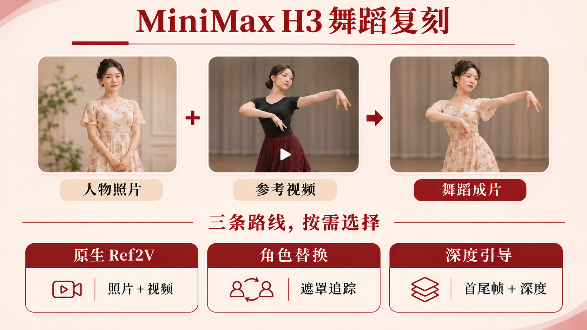

# MiniMax H3 Dance Replica

[English](README.md) | 中文

供 Codex 使用的舞蹈复刻 Skill。提供一张人物照片和一段参考视频，通过 MiniMax H3 和 ComfyUI 生成新人物的舞蹈视频，并保留原音乐。

## 效果

### [红裙完整舞蹈 · 14.29 秒](assets/videos/wine-dress-full-dance.mp4)

https://github.com/user-attachments/assets/60f3d8de-1491-41bc-88f9-36170e7ef873

### [红裙转身舞蹈 · 7.17 秒](assets/videos/wine-dress-depth-dance.mp4)

https://github.com/user-attachments/assets/289cb5e0-4bcd-435f-abb6-ec246b457975

### [碎花裙舞蹈 · 8.17 秒](assets/videos/ref2v-floral.mp4)

https://github.com/user-attachments/assets/57031253-132d-4518-b507-9b273f4e176a

人物细节与动作仍可能存在偏差。

## 安装

需要 Python 3.10+、FFmpeg，以及可连接的 ComfyUI 或兼容 API。

在 Codex 中发送：

> 安装这个 Skill 并检查运行环境：https://github.com/chemny/minimax-h3-dance-replica

## 使用

提供人物照片、参考视频和服务地址，告诉 Codex：

> 用这张照片中的人物复刻这个视频的舞蹈，保留原音乐。

可选原生 Ref2V、Character Swap、深度引导三条路线。

## 文档

[安装指南](references/installation.md) · [工作流](references/routes.md) · [运行参数](references/runtime.md) · [任务恢复](references/recovery.md) · [原理与组件](references/architecture.md)

---

代码与文档采用 [MIT](LICENSE)，模型、上游组件和演示媒体不在该许可范围。作者：[Neo Chen（chemny）](https://github.com/chemny)。
