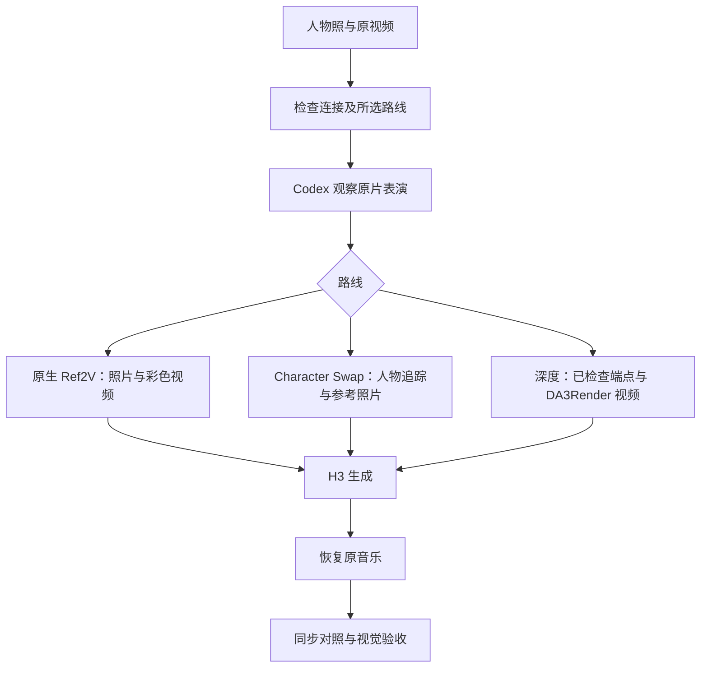

# 工作流与组件

Codex 负责观察表演和判断画面质量，脚本负责可重复的素材处理、工作流提交和后处理。

| 组件 | 职责 |
|---|---|
| `SKILL.md` | 路线选择、素材角色和验收规则 |
| `dance.py`、`routes.py`、`profiles.py` 与预设 | 统一任务入口及明确的模型／采样配方 |
| `direct_routes.py`、`h3_run.py` 与 Character Swap 图 | 构建选定的 H3 工作流 |
| `native_client.py`、`workflow_client.py` | 上传、提交、取图及恢复同一任务 |
| 环境检测器、`runtime_checks.py`、`model_inventory.py` | 检查客户端与服务端条件，列出固定版本的模型来源 |
| `media.py`、`stages.py`、`segments.py` | 准备时间轴、保存本地处理检查点、恢复音轨及拼接深度片段 |
| `prompt.py`、`compare.py` | 编译实际观察记录，生成供视觉验收的同步对照 |
| `depth_remote.py` | 在已有服务器 Python 环境中运行 DA3 的可选辅助脚本 |



环境检测、模型清单和图校验可以独立执行，不生成视频。深度使用原生 ComfyUI，另外两条路线也可通过兼容工作流 API 调用。

## 目录结构

```text
minimax-h3-dance-replica/
├── SKILL.md
├── agents/openai.yaml
├── scripts/                   任务入口、客户端、素材处理与环境工具
├── presets/                   配方与固定版本的模型元数据
├── assets/                    Character Swap 工作图和效果预览
├── examples/                  任务配置；不含示例媒体
├── references/                安装、路线、恢复和验收说明
├── tests/                     仅 CPU 的路由、协议与恢复检查
├── Check-Environment.bat
├── requirements.txt           客户端 Python 包
├── README.md
└── README.zh.md
```

技能包含指引、脚本、工作流图和三个演示视频，不打包模型权重和原片。详细内容见[运行命令](runtime.md)、[安装指南](installation.md)、[路线配方](routes.md)、[恢复说明](recovery.md)和[开发检查](development.md)。

